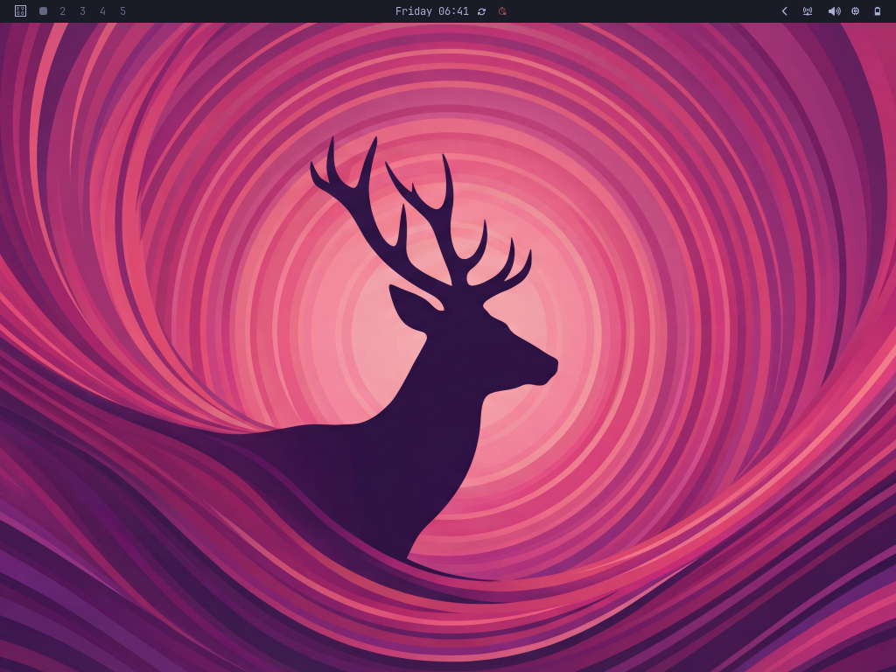

# Omarchy on the iPad 2 (iPad2,1 / K93AP) — ABANDONED, NOT RECOMMENDED

> **🛑 Status: abandoned. This was an experiment. Do not use it.**
>
> It boots, the touch screen works, and Omarchy 3.8 runs on Hyprland. The
> screenshot below proves that it runs, and that is all it proves. Every frame
> is drawn by the CPU (two 1 GHz Cortex-A9 cores), so opening a menu takes
> seconds. Omarchy is driven from the keyboard, so touch alone gets stuck in
> its menus. There is no sound, no Wi-Fi and no buttons. **The same iPad on
> jailbroken iOS 8.4.1 is smoother, and everything works there.** The goal was
> to watch YouTube or Twitch in a normal browser; that is not possible here
> (see [Findings](#findings)). Nothing more will be done on this branch.
>
> **ES — Abandonado. Fue un experimento y NO SE RECOMIENDA.** Arranca, el
> touch funciona y Omarchy 3.8 corre sobre Hyprland: la captura muestra que
> funciona, pero es solo eso. Todo lo dibuja la CPU, abrir un menú tarda
> segundos, y sin teclado no se sale de los menús. No hay sonido, ni Wi-Fi,
> ni botones. El mismo iPad con iOS 8.4.1 y jailbreak es más fluido y todo
> funciona. El objetivo era ver YouTube o Twitch en un navegador normal, y eso
> no es posible en este hardware. Este proyecto no seguirá.



This branch ports [Project Cascadia](../README.md) — mainline Linux 6.12 for
the A5, written for the iPad mini 1 (iPad2,5 / P105) — to the iPad 2 Wi-Fi
(iPad2,1 / K93AP, S5L8940X), and puts Omarchy on top. Linux runs from RAM with
its root over NFS from the host; iOS is never written to.

## What works

| | |
|---|---|
| Boot without extra hardware | kDFU from a jailbroken iOS 8.4.1, no Pi Pico |
| Unattended boot | `k93/ipad-boot`: watchdog reset → iOS → kDFU → Linux → desktop |
| Display | simpledrm over iBoot's scanout, 1024×768 (landscape, 4096-byte stride) |
| Both CPU cores | MPIDR 0x900/0x901 |
| Touch | Z2F13 digitizer brought up the way iOS does it, calibrated through libinput |
| Desktop | Omarchy 3.8.4 on Hyprland 0.54.3, Mesa llvmpipe |
| Watchdog | `tools/k93-wdt-pet.sh` resets a hung Linux back into iOS |

Not working: Wi-Fi (BCM4329 on SDIO), Bluetooth, buttons, audio, the GPU
(Cascadia's SGX driver is GLES 2; Hyprland needs GLES 3).

## What was different from the iPad mini

Everything below was read from the K93 device tree, the 12H321 kernelcache,
or the running hardware:

- **iBEC auto-go hook:** the same code at different addresses — hook
  `0x2366C`, cache flush `0x9FF20F84`, done flag `0x9FF4B2B0`, USB continue
  `0x9FF200E0`, cave `0x45C74` (`scripts/firmware/patch-ibec-autogo-k93.py`).
- **A bug in the upstream patcher, fixed here:** the build image's toolchain
  put a 0x24-byte `.note.gnu.build-id` before `.text`, so every branch was
  computed from the wrong address. `-no-pie -Wl,--build-id=none` fixes it, and
  the P105 image reproduces its reference MD5 again.
- **Framebuffer:** the K93 panel scans out landscape, 1024×768, 4096-byte lines.
- **CPU:** the cores are MPIDR `0x900`/`0x901` (P105: `0xa00`/`0xa01`).
- **Touch (`z2-boot -K`):**
  - the digitizer is `multi-touch,k94` / Z2F13,2, with the plain Z2 bootloader
    (not N1);
  - GPIOs: reset 141, CS 159, IRQ 21, download 140, **active low**;
  - power: PMU `0x20` bit `0x20` (LDO 0);
  - the 32 kHz clock is PMU GPIO0 in mode `0x51`;
  - firmware execute address `0x10001800`, calibration at `0x1000c000`;
  - calibration sequence: `fll-mval` `0x18da` at `0x10001c04`, and three more
    register writes taken from `MTSPIBootloader_Z2`.
- **Remote reset:** writing the SoC watchdog (`0x3f103020`) brings the iPad back
  to iOS with nobody touching it.

## Running Omarchy on armv7 Alpine

Omarchy targets Arch on x86_64/aarch64. Here, Omarchy 3.8.4 (the last release
whose Hyprland config is `hyprland.conf`; 4.x needs Lua config support that
Alpine's armv7 Hyprland 0.54.3 lacks) is installed the way its installer does
it: the repo in `~/.local/share/omarchy`, `config/` into `~/.config`, the theme
set with `omarchy-theme-set`. What armv7 Alpine lacks is shimmed
(`k93/bin/`):

- `uwsm-app` runs the app directly;
- `walker` becomes fuzzel;
- swayosd, hypridle and hyprlock do nothing.

Things that had to be found out:

- Hide the SGX's `renderD128` from the session user, or Mesa picks it and falls
  into zink. Do **not** set `MESA_LOADER_DRIVER_OVERRIDE=kms_swrast`: GBM on
  simpledrm loads it by itself, and forcing it breaks EGL.
- Clients need `env = LIBGL_ALWAYS_SOFTWARE,1`.
- Start the system D-Bus and PipeWire yourself (no systemd), and start the
  session from `$HOME` (Waybar's CSS imports are relative).
- Turn off animations, blur and shadows (`k93/hypr/looknfeel-ipad2.conf`), and
  keep `misc:vfr` on: with it off, Hyprland burns 40% CPU doing nothing.

`k93/omarchy-ipad/` and `omarchy-session` are a lighter Omarchy-style sway
setup (pixman renderer) tried first.

## Findings

What was measured on the device, and why the project stopped.

**Video works, without a desktop.** `mpv --vo=drm --hwdec=no` straight on
the framebuffer (no compositor), CPU decode only:

| Source | Result |
|---|---|
| YouTube 360p (H.264), via yt-dlp | smooth, 0 dropped frames |
| Twitch 360p, via streamlink | smooth, 0 dropped frames |
| local 720p H.264 file | 6 dropped frames in 8 s at 30 fps |

YouTube needs `nodejs` for yt-dlp and the `mweb` player client to get past
its bot check, and then only offers 360p. Higher qualities need PO tokens.
There is no sound, so this is still not usable.

**A normal browser is out of reach, whatever the drivers.**

- On iOS, the iPad 2 stops at iOS 9.3.5, and its Safari can no longer load
  today's YouTube or Twitch. A jailbreak can't replace the browser engine.
- On Linux, a modern browser would load the pages, but YouTube or Twitch in
  a browser needs about as much memory as the iPad has: 512 MB. Getting the
  GPU working would make the interface smooth. It would not add memory or
  CPU, so the browser would still be unusable.
- Chromium is barely built for 32-bit ARM any more; Firefox is what's left.

**What full hardware support would and would not buy:**

| | Interface | YouTube/Twitch in a browser |
|---|---|---|
| As it is (CPU rendering) | very slow | not viable |
| With GPU and video decoder | smooth, about like iOS | still too heavy (512 MB RAM) |
| Lightweight player (mpv) | fine | plays, but it is not a browser |

- **GPU** (PowerVR SGX543MP2): Cascadia's driver reaches GLES 2. Hyprland
  needs GLES 3, and sway's GLES 2 renderer was not tried.
- **Video decoder:** no Linux driver exists; writing one means reverse
  engineering the block.
- **Booting from the iPad itself, without RAM or NFS:** there is no driver
  for the internal NAND. The A5 also can't start Linux on its own: it always
  needs iOS (kloader, as here), a Pi Pico, or a computer over USB.

**Not started:** audio, Wi-Fi (BCM4329 on SDIO), buttons.

## Building and booting

Needs a jailbroken iPad 2 on iOS 8.4.1 with OpenSSH,
[Legacy iOS Kit](https://github.com/LukeZGD/Legacy-iOS-Kit), Docker, and your
own `iPad2,1_8.4.1_12H321_Restore.ipsw`. No Apple firmware is in this
repository: the iBEC, the touch firmware (`K93.mtprops`) and the panel
calibration come from your IPSW and your iPad.

```bash
IPSW=ipad21.ipsw bash scripts/build-firmware-k93.sh    # inside the build image
DTS=dts/k93ap.dts KCONFIG_EXTRA=config/k93ap.config ./cascadia build
IPAD_IP=<iPad Wi-Fi address> k93/ipad-boot
```

All credit for the A5 port itself goes to Project Cascadia and the people it
credits; this branch adds the K93 board and the Omarchy experiment.
